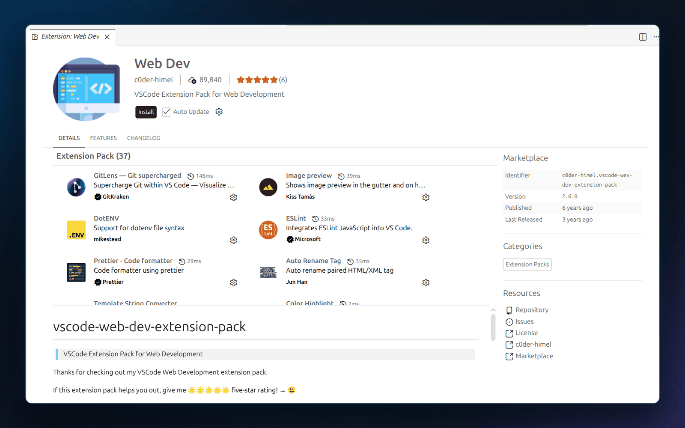

<div align="center">

# Web Dev

### A curated VS Code extension pack for modern web development

One install. 37 extensions. Everything you need for HTML, CSS, JavaScript, React, Tailwind CSS, Git, and a faster workflow.

[](https://marketplace.visualstudio.com/items?itemName=c0der-himel.vscode-wev-dev-extension-pack)
[](https://marketplace.visualstudio.com/items?itemName=c0der-himel.vscode-wev-dev-extension-pack)
[](https://marketplace.visualstudio.com/items?itemName=c0der-himel.vscode-wev-dev-extension-pack&ssr=false#review-details)
[](https://github.com/dev-himel-0o0/vscode-web-dev-extension-pack/blob/main/LICENSE)
[](https://code.visualstudio.com/)

**[Install from the VS Code Marketplace →](https://marketplace.visualstudio.com/items?itemName=c0der-himel.vscode-wev-dev-extension-pack)**

*Free · MIT licensed · Works with VS Code 1.76.2+*

</div>



<p align="center"><sub>The Web Dev extension page in VS Code — 37 curated extensions in one install.</sub></p>

## Overview

**Web Dev** is a curated [VS Code extension pack](https://code.visualstudio.com/api/references/extension-manifest#extension-packs) that turns a fresh editor into a complete front-end development environment in one install. It brings together 37 extensions for HTML, CSS, JavaScript, TypeScript, React, Tailwind CSS, styled-components, Git, linting, formatting, and everyday editor productivity.

Instead of searching the Marketplace for each tool, you install one extension. VS Code resolves the pack and installs every member for you. The pack ships **no runtime code, no npm packages, and no build step** — each included extension is maintained by its own publisher and updates independently.

It is built for front-end developers, React and Tailwind projects, students, teams that want a shared baseline setup, and anyone starting on a new development machine.

## Key Features

- **One install, complete toolkit** — 37 curated extensions install from a single Marketplace entry.
- **HTML & CSS superpowers** — auto-rename paired tags, highlight matching tags, class-name completion across HTML and CSS, auto-prefixing, and inline color previews.
- **JavaScript & React workflow** — ES6/React snippets, ESLint feedback, Prettier formatting, template-string conversion, and styled-components support.
- **Tailwind CSS IntelliSense** — autocomplete, syntax highlighting, linting, and hover previews for utility classes.
- **Errors in context** — Error Lens and Error Gutters show diagnostics directly on the line where they occur.
- **Cleaner code** — remove console logs, catch typos, trim trailing whitespace, and keep TODO comments visible.
- **Git visibility** — GitLens and Git Graph bring blame, history, and branch visualization into the editor.
- **Editor polish** — Material Icon Theme, GitHub Theme, Color Highlight, Rainbow Tags, and more.
- **No overhead from the pack itself** — the pack adds no code or package dependencies; it only declares its members.
- **Open and free** — MIT licensed and maintained in public on GitHub.

## What's Included

The pack currently ships **37 extensions** across six areas. Every extension below is a member declared in the [`extensionPack`](https://github.com/dev-himel-0o0/vscode-web-dev-extension-pack/blob/main/package.json) array, and VS Code installs all of them when the pack is installed.

| Area | Extensions |
| --- | --- |
| **HTML, CSS & Markup** | [Auto Rename Tag](https://marketplace.visualstudio.com/items?itemName=formulahendry.auto-rename-tag), [Highlight Matching Tag](https://marketplace.visualstudio.com/items?itemName=vincaslt.highlight-matching-tag), [IntelliSense for CSS class names in HTML](https://marketplace.visualstudio.com/items?itemName=Zignd.html-css-class-completion), [HTML to CSS autocompletion](https://marketplace.visualstudio.com/items?itemName=solnurkarim.html-to-css-autocompletion), [className Completion in CSS](https://marketplace.visualstudio.com/items?itemName=zitup.classnametocss), [css-auto-prefix](https://marketplace.visualstudio.com/items?itemName=sporiley.css-auto-prefix), [Color Info](https://marketplace.visualstudio.com/items?itemName=bierner.color-info), [Color Highlight](https://marketplace.visualstudio.com/items?itemName=naumovs.color-highlight), [Rainbow Tags](https://marketplace.visualstudio.com/items?itemName=voldemortensen.rainbow-tags) |
| **JavaScript, TypeScript & React** | [ESLint](https://marketplace.visualstudio.com/items?itemName=dbaeumer.vscode-eslint), [ES7+ React/Redux/React-Native snippets](https://marketplace.visualstudio.com/items?itemName=dsznajder.es7-react-js-snippets), [JavaScript (ES6) code snippets](https://marketplace.visualstudio.com/items?itemName=xabikos.javascriptsnippets), [Template String Converter](https://marketplace.visualstudio.com/items?itemName=meganrogge.template-string-converter), [es6-string-html](https://marketplace.visualstudio.com/items?itemName=Tobermory.es6-string-html), [Remove Console Log](https://marketplace.visualstudio.com/items?itemName=c0der-himel.remove-console-log), [Inline fold](https://marketplace.visualstudio.com/items?itemName=moalamri.inline-fold) |
| **Styling** | [Tailwind CSS IntelliSense](https://marketplace.visualstudio.com/items?itemName=bradlc.vscode-tailwindcss), [vscode-styled-components](https://marketplace.visualstudio.com/items?itemName=styled-components.vscode-styled-components) |
| **Code Quality & Formatting** | [Prettier - Code formatter](https://marketplace.visualstudio.com/items?itemName=esbenp.prettier-vscode), [Error Lens](https://marketplace.visualstudio.com/items?itemName=usernamehw.errorlens), [Error Gutters](https://marketplace.visualstudio.com/items?itemName=igorsbitnev.error-gutters), [Code Spell Checker](https://marketplace.visualstudio.com/items?itemName=streetsidesoftware.code-spell-checker), [Trailing Spaces](https://marketplace.visualstudio.com/items?itemName=shardulm94.trailing-spaces), [Better Comments](https://marketplace.visualstudio.com/items?itemName=aaron-bond.better-comments), [TODO Highlight](https://marketplace.visualstudio.com/items?itemName=wayou.vscode-todo-highlight) |
| **Git & Collaboration** | [GitLens — Git supercharged](https://marketplace.visualstudio.com/items?itemName=eamodio.gitlens), [Git Graph](https://marketplace.visualstudio.com/items?itemName=mhutchie.git-graph) |
| **Productivity & Editor** | [Live Server](https://marketplace.visualstudio.com/items?itemName=ritwickdey.LiveServer), [Code Runner](https://marketplace.visualstudio.com/items?itemName=formulahendry.code-runner), [DotENV](https://marketplace.visualstudio.com/items?itemName=mikestead.dotenv), [EditorConfig](https://marketplace.visualstudio.com/items?itemName=editorconfig.editorconfig), [Image preview](https://marketplace.visualstudio.com/items?itemName=kisstkondoros.vscode-gutter-preview), [Output Colorizer](https://marketplace.visualstudio.com/items?itemName=ibm.output-colorizer), [Material Icon Theme](https://marketplace.visualstudio.com/items?itemName=PKief.material-icon-theme), [GitHub Theme](https://marketplace.visualstudio.com/items?itemName=github.github-vscode-theme), [IntelliCode](https://marketplace.visualstudio.com/items?itemName=visualstudioexptteam.vscodeintellicode), [IntelliCode Completions](https://marketplace.visualstudio.com/items?itemName=visualstudioexptteam.vscodeintellicode-completions) |

> **Made by the same author:** [Remove Console Log](https://marketplace.visualstudio.com/items?itemName=c0der-himel.remove-console-log) is a companion extension built for this pack. It removes all console logs from the active file.

## Tech Stack

| Technology | Role in the project |
| --- | --- |
| **VS Code Extension Manifest** (`package.json`) | Declarative metadata; the `extensionPack` array is the entire functional definition of the project. |
| **VS Code extension host** | Resolves, installs, activates, and updates the pack and its member extensions. |
| **`@vscode/vsce`** | Official CLI used to package the `.vsix` and publish releases. |
| **VS Code Marketplace** | Distribution, discovery, installs, reviews, and update delivery. |
| **Git & GitHub** | Source control, issue tracking, and public collaboration. |
| **Markdown & badges** | A single README powers both the GitHub landing page and the Marketplace listing. |

**Not used:** there is no application runtime, no bundler, no TypeScript build, and no custom UI. That is deliberate — an extension pack should stay declarative and let VS Code do the installation work.

## Dependencies

### Runtime dependencies

**None.** The repository contains no application code and no third-party npm packages. `package-lock.json` has no dependencies, and installing the pack does not run any project code.

### Extension dependencies

The pack's functional dependencies are the **37 extensions** listed in [What's Included](#whats-included). The authoritative list is the `extensionPack` array in [`package.json`](https://github.com/dev-himel-0o0/vscode-web-dev-extension-pack/blob/main/package.json).

### Development tooling

| Tool | Version | Purpose |
| --- | --- | --- |
| [VS Code](https://code.visualstudio.com/) | 1.76.2+ | Runs the Extension Development Host |
| [Node.js](https://nodejs.org/) + npm | 20+ (recommended) | Runs `@vscode/vsce` for packaging and publishing |
| [`@vscode/vsce`](https://github.com/microsoft/vscode-vsce) | Latest via `npx` | Builds the VSIX and publishes to the Marketplace |
| [Git](https://git-scm.com/) | Any recent version | Clones the repository |

No `npm install` is required for normal use or for loading the pack.

## Run Locally

### Prerequisites

- [VS Code](https://code.visualstudio.com/) **1.76.2 or newer**
- [Git](https://git-scm.com/)
- [Node.js](https://nodejs.org/) **20+** and npm (only needed for packaging/publishing)

### 1. Clone the repository

```bash
git clone https://github.com/dev-himel-0o0/vscode-web-dev-extension-pack.git
cd vscode-web-dev-extension-pack
```

### 2. Open the project in VS Code

```bash
code .
```

You can also open the folder manually with **File → Open Folder…** and select the cloned directory.

### 3. Start the Extension Development Host

- Open **Run and Debug** with <kbd>Ctrl</kbd>+<kbd>Shift</kbd>+<kbd>D</kbd> (<kbd>Cmd</kbd>+<kbd>Shift</kbd>+<kbd>D</kbd> on macOS).
- Press <kbd>F5</kbd>, or choose **Run → Start Debugging**.
- A second VS Code window opens with the extension pack loaded.

> The development host loads the pack itself. To test the complete 37-extension install exactly as Marketplace users experience it, follow step 5 and install the packaged VSIX.

### 4. Iterate on the pack

- Add or remove an extension ID in the `extensionPack` array in [`package.json`](https://github.com/dev-himel-0o0/vscode-web-dev-extension-pack/blob/main/package.json).
- Restart the debug session (<kbd>F5</kbd>) to reload the pack.
- Update the version in `package.json` and add an entry to [`CHANGELOG.md`](https://github.com/dev-himel-0o0/vscode-web-dev-extension-pack/blob/main/CHANGELOG.md) when preparing a release.

### 5. Package and install a VSIX

```bash
# Creates vscode-wev-dev-extension-pack-<version>.vsix
npx --yes @vscode/vsce package

# Install the generated VSIX into your local VS Code
code --install-extension vscode-wev-dev-extension-pack-*.vsix
```

Reload VS Code after installation. The pack and all 37 member extensions will be installed.

### 6. Publish a new version (optional)

```bash
npx --yes @vscode/vsce publish
```

Make sure the `version` in `package.json` is higher than the latest release on the Marketplace. Publishing requires Marketplace publisher credentials — Microsoft Entra ID automated publishing (recommended) or a personal access token. See the official [publishing guide](https://code.visualstudio.com/api/working-with-extensions/publishing-extension) for setup instructions.

## Why These Technologies?

### Why an extension pack instead of a custom extension?

- **Official and native.** Extension packs are a first-class VS Code feature. The entire project is a declarative list, so there is no custom activation code, UI, or background process to maintain.
- **Upstream maintenance.** Each extension is maintained by its own publisher. Bug fixes, security patches, and new features arrive through normal extension updates instead of being reimplemented here.
- **Smaller trust surface.** Nothing is vendored or re-bundled. Users can inspect, disable, or uninstall any individual extension and can see exactly what the pack contains.
- **Better updates.** VS Code installs the latest compatible version of each member. The pack does not pin old releases or become a stale fork of tools that already exist.
- **Lower build complexity.** No bundler, no compiled output, no release artifacts to debug — just a manifest, a changelog, and documentation.

A custom extension that tried to reproduce all 37 tools would duplicate a huge amount of maintenance, lag behind upstream fixes, and take control away from users. An extension pack is the right level of abstraction.

### Why this particular set of extensions?

- **Coverage of the whole workflow.** The set spans markup, styling, JavaScript/React, linting, formatting, Git, and editor productivity, so a new front-end project is usable immediately.
- **Established, widely used tools.** The list favors mature extensions with active publishers and large user bases — Prettier, ESLint, GitLens, Live Server, Tailwind CSS IntelliSense, and Material Icon Theme, for example.
- **Complementary rather than identical.** Some tools overlap by design (for example, CSS class completion works in different directions and contexts), and users can disable anything that does not fit their workflow.
- **Practical quality-of-life additions.** Small tools such as Error Lens, TODO Highlight, and Remove Console Log remove daily friction without changing how a project is built.

### Why VS Code Marketplace and `vsce`?

The Marketplace is where VS Code users already discover and install extensions. It provides one-click installation, automatic updates, version history, reviews, and a familiar trust model. `@vscode/vsce` is the official packaging and publishing CLI, so the project avoids a custom distribution pipeline.

## Problems This Project Solves

| Problem | How the pack helps |
| --- | --- |
| **Setup fatigue** | 37 extensions install from one Marketplace entry instead of 37 separate searches and installs. |
| **Choice paralysis** | The list is curated and grouped, so users do not have to evaluate dozens of overlapping tools before writing code. |
| **Inconsistent team setups** | Everyone can start from the same baseline toolchain, which reduces "works on my machine" editor differences. |
| **Missing quality tooling** | Formatting, linting, spell checking, diagnostics, and Git history are available from the first file. |
| **Onboarding friction** | New developers, students, and new machines get a productive web setup in minutes. |
| **Maintenance overhead** | The pack contains no code to update; upstream extensions keep themselves current. |

The project does not ship settings or keybindings, so it stays unopinionated about how a team configures Prettier, ESLint, or editor preferences.

## Challenges & Lessons Learned

- **Curation vs. bloat.** Thirty-seven extensions is already a lot; every addition adds install time, startup work, and UI surface. Each candidate has to justify its place against overlap, maintenance status, and usefulness to a typical web project. This is why deprecated extensions were removed in v2.2.0 and replaced with maintained alternatives.
- **Upstream churn.** The pack does not pin extension versions, so users receive the latest releases. An upstream deprecation, regression, or a raised minimum VS Code version can change the experience without any code change in this repository, so the list needs periodic audits.
- **Compatibility across editor versions.** The manifest targets VS Code `^1.76.2` to stay available to older installs, but individual extensions set their own engine requirements. Testing the current VS Code release alongside the minimum supported version is part of a responsible release.
- **A permanent Marketplace identity.** The published ID contains `wev` instead of `web`. Renaming it would break existing installs, bookmarks, and review links, so the original ID is kept for backward compatibility. The lesson: choose a Marketplace ID carefully, because it is effectively permanent.
- **Documentation and manifest drift.** The README is both the GitHub landing page and the Marketplace listing, and images must be included in the VSIX package. Keeping the extension table, version numbers, screenshot, and changelog in sync takes deliberate effort.
- **Keeping defaults out of the way.** Several extensions touch formatting, comments, diagnostics, and completion. The goal is a set that coexists cleanly and lets users turn off anything they do not need, rather than a pile of maximum-strength defaults.

## Links

- **Live extension (VS Code Marketplace):** [Web Dev](https://marketplace.visualstudio.com/items?itemName=c0der-himel.vscode-wev-dev-extension-pack)
- **Source code:** [github.com/dev-himel-0o0/vscode-web-dev-extension-pack](https://github.com/dev-himel-0o0/vscode-web-dev-extension-pack)
- **Report an issue / request an extension:** [GitHub Issues](https://github.com/dev-himel-0o0/vscode-web-dev-extension-pack/issues)
- **Changelog:** [CHANGELOG.md](https://github.com/dev-himel-0o0/vscode-web-dev-extension-pack/blob/main/CHANGELOG.md) · [Marketplace version history](https://marketplace.visualstudio.com/items?itemName=c0der-himel.vscode-wev-dev-extension-pack&ssr=false#version-history)
- **License:** [MIT](https://github.com/dev-himel-0o0/vscode-web-dev-extension-pack/blob/main/LICENSE)
- **Publisher:** [c0der-himel on the VS Code Marketplace](https://marketplace.visualstudio.com/publishers/c0der-himel)
- **Companion extension:** [Remove Console Log](https://marketplace.visualstudio.com/items?itemName=c0der-himel.remove-console-log)
- **Documentation:** [VS Code Extension Packs](https://code.visualstudio.com/api/references/extension-manifest#extension-packs) · [VS Code Extension API](https://code.visualstudio.com/api) · [vsce](https://github.com/microsoft/vscode-vsce)

> **About the Marketplace ID:** the published ID is `c0der-himel.vscode-wev-dev-extension-pack` (with "wev"). It is kept unchanged so existing installs and links continue to work.

## Contributing

Suggestions and pull requests are welcome. If you propose a new extension, please include:

- the Marketplace extension ID;
- why it belongs in a general-purpose web development pack;
- confirmation that it is maintained and works with VS Code 1.76.2 or newer.

For bugs inside an included extension, please report them to that extension's publisher first. Issues in this repository are for the pack itself — an incorrect ID, a missing update, or a suggestion for the collection.

## Support the Project

If this pack saves you time, a ⭐ on GitHub and a ★★★★★ review on the Marketplace are greatly appreciated.

[Star the repository](https://github.com/dev-himel-0o0/vscode-web-dev-extension-pack) · [Leave a review](https://marketplace.visualstudio.com/items?itemName=c0der-himel.vscode-wev-dev-extension-pack&ssr=false#review-details)

## License

Released under the [MIT License](https://github.com/dev-himel-0o0/vscode-web-dev-extension-pack/blob/main/LICENSE). © 2021 MD. Shahadat Hussain.
